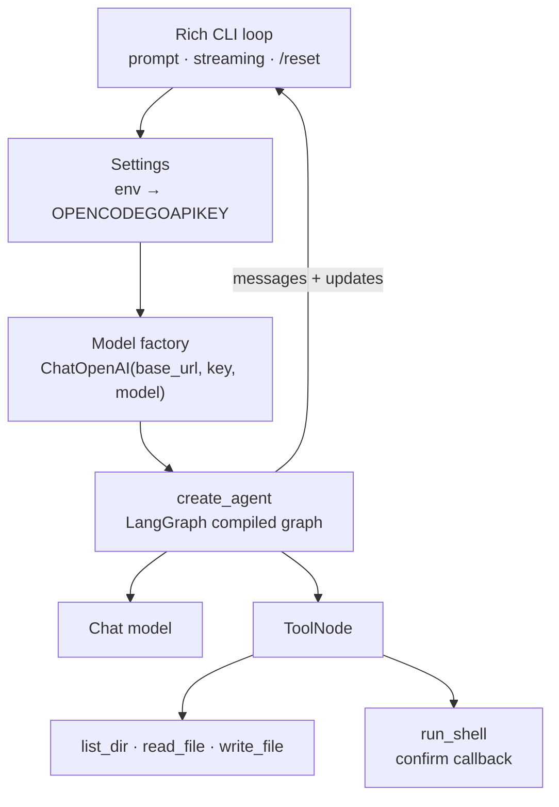

# Baby LangGraph Code Agent - Plan

## Goal Capsule

- **Objective:** A developer can start one command in a repository, describe a coding task in natural language, and watch a tool-using agent read, search, edit, and verify files in that repository from a Rich terminal UI.
- **Means:** A LangGraph agent built with LangChain v1 `create_agent`, an OpenAI-compatible chat model pointed at OpenCode Go, filesystem and shell tools rooted at the working directory, and a streaming Rich REPL (KTD1, KTD2, KTD3, KTD4).
- **Authority:** This plan governs scope and verification. Repository files govern implementation facts. The LangChain docs MCP is the tie-breaker for API shape; where docs and plan disagree, docs win and the plan's unit approach is adjusted, not the product requirements.
- **Execution profile:** One PR, six units, single branch. No remote exists at plan time, so shipping may end at a local commit.
- **Who finishes:** `ce-work` implements and commits; `lfg` reviews, simplifies, and ships according to the repository's remote state.

## Product Contract

### Summary

Build a small, readable Python code agent in this empty repository. It runs an interactive terminal session, streams model output, exposes four tools (`list_dir`, `read_file`, `write_file`, `run_shell`), and keeps one conversation thread per process. It authenticates with the `OPENCODEGOAPIKEY` environment variable and uses the OpenCode Go OpenAI-compatible endpoint. LangChain APIs must be verified against the LangChain docs MCP before implementation because that ecosystem changes quickly.

### Problem Frame

The repository currently contains no application code. Building a code agent from scratch usually forces a choice between an opaque framework and an unmaintainable hand-rolled tool loop. This project exists to produce a small reference implementation that is both teachable (the graph and tool loop are visible) and current (built on the LangChain v1 / LangGraph APIs the official docs recommend today). A terminal-only surface keeps the project reviewable in one sitting and makes the agent usable on any machine with a shell.

### Requirements

**Runtime and configuration**

- R1. Starting the application without `OPENCODEGOAPIKEY` set exits with a clear, actionable error that names the variable and does not print or echo any key value.
- R2. The chat model is created through LangChain against an OpenAI-compatible endpoint: base URL `https://opencode.ai/inference/go/openai/v1`, API key read from `OPENCODEGOAPIKEY`, model name from `OPENCODEGO_MODEL` with a working default.
- R3. The application runs on Python 3.12 and its declared dependencies install through a single `uv sync` in a clean checkout.

**Agent behavior**

- R4. The agent answers a coding request by calling tools in a loop until it produces a final text answer; a single request can require multiple tool calls.
- R5. Available tools are `list_dir`, `read_file`, `write_file`, and `run_shell`; each has a docstring the model can use and returns a plain-text result or an explicit error string.
- R6. Filesystem tools resolve paths relative to the process working directory and refuse any path that escapes it.
- R7. `run_shell` asks the user for confirmation before execution and returns a clear "denied" result when refused; an accepted command runs with the working directory as cwd and a bounded timeout.
- R8. The conversation persists across turns in one process so a follow-up can refer to earlier work, and a reset command starts a fresh thread.

**Terminal experience**

- R9. The terminal shows model output as it streams rather than after the full response finishes.
- R10. Each tool call is visible in the terminal with its name and a short summary of its arguments; tool failures are visible without crashing the session.
- R11. The session provides a banner, a prompt, per-turn error recovery (an API or tool error ends that turn, not the process), and the commands `/help`, `/reset`, and `/exit`.

### Key Decisions

- **The LangChain docs MCP is the source of truth for API shape.** The user named it explicitly; the ecosystem changes faster than model knowledge. Governs R2, R4, R9.
- **Terminal-only surface for this iteration.** A web UI or TUI framework was not requested and would multiply the unverified surface. Governs R9, R10, R11.
- **Small explicit tool set instead of a plugin registry.** Four tools cover read/search/edit/verify; a registry is deferred until a second consumer exists. Governs R5.

### Scope Boundaries

In scope: the agent runtime, its four tools, the terminal REPL, configuration, tests, and a README that explains setup and the approval behavior.

Deferred to Follow-Up Work: a persistent (SQLite) checkpointer, MCP client tools, subagents, multi-file diff review, non-interactive/headless execution, and a plain-print renderer for redirected or non-TTY output.

Outside this product's identity: a general-purpose IDE, a sandboxed container runtime, and hosted multi-user service behavior.

### Success Criteria

- A fresh clone reaches a running prompt with `uv sync` plus one environment variable.
- A representative request ("read the README and add a missing section") completes with visible tool calls and a final answer.
- `uv run pytest` passes with no network access required.
- No secret value appears in terminal output, logs, or exception text.

## Planning Contract

### Key Technical Decisions

KTD1. **Build the graph with LangChain v1 `create_agent`.** The docs' current agent API returns a compiled LangGraph graph with the model/tool loop, checkpointing, and streaming already wired. Chosen over a hand-wired `StateGraph` because the documented API is the one the ecosystem supports and it still exposes a LangGraph object for later extension. (Directive: cold request "build with LangGraph"; research confirmed `create_agent` is the documented LangGraph-backed path.)

KTD2. **Use `ChatOpenAI` from `langchain-openai` against OpenCode Go.** No first-party LangChain integration for OpenCode Go exists; the provider is OpenAI-compatible. Construct the model with `base_url`, `api_key`, and the model id, then pass the instance to `create_agent`. Chosen over raw `openai` SDK calls because tool binding, messages, and streaming must stay in LangChain types. (Directive: cold request naming the environment variable; the endpoint is fixed by R2.)

KTD3. **Root every tool at the process working directory and gate only `run_shell`.** Path resolution rejects escapes (`..`, absolute paths outside root) for read/list/write. Shell is the only irreversible surface, so it prompts through an injected confirm callback; a denial returns a normal tool result so the model can recover. Chosen over prompting on every write because file edits are the agent's core function and are recoverable in version control.

KTD4. **Stream with `stream_mode=["messages", "updates"]` and render through `rich.Live`.** `messages` yields token chunks; `updates` yields tool-call and tool-result messages. Chosen over `invoke()` plus one final print because R9 requires live output and the docs document this exact mode pair.

KTD5. **Keep the model factory pure and injectable.** A settings object reads environment variables; a factory builds the chat model and agent. Tests substitute a LangChain fake chat model so the suite runs offline. Chosen over importing a module-level singleton so the tool loop can be tested deterministically.

KTD6. **Use `uv` with a `pyproject.toml` and a `src/` layout.** The machine has `uv` and `.python-version` already pins 3.12. Chosen over `requirements.txt` because locking and interpreter selection come free and CI-less local setup stays one command.

KTD7. **Test with `pytest` and a recorded Rich console.** `langchain_core` fake chat models script tool calls and final answers; `rich.console.Console(record=True)` captures terminal output. Chosen over live API tests so verification does not depend on a key or network.

### High-Level Technical Design

Turn sequence: the CLI reads a line, appends the user message to the agent input, streams `messages` chunks into a `Live` markdown block, renders `updates` tool-call entries in a bordered panel, prompts before any shell command, and then returns to the prompt. Tool exceptions are converted to error strings at the tool boundary so a failed tool cannot kill the graph.

### Assumptions

- The OpenCode Go endpoint accepts OpenAI-compatible chat-completions requests with tool calling and streaming.
- The default model `deepseek-v4.1-flash` is available to the key holder; `OPENCODEGO_MODEL` lets the user choose another without code changes.
- The primary platform is Windows with `cmd.exe`, but the shell tool uses the platform default shell and must not assume POSIX-only commands.
- No sandbox/container isolation is assumed; the approval prompt is the safety boundary.

### Risks & Dependencies

- **LangChain API drift.** `create_agent`, streaming modes, and middleware have changed across releases. Mitigation: pin `langchain` and `langgraph` to the versions resolved at implementation time, and check signatures against the docs MCP during U4.
- **Provider incompatibility.** Tool calling, streaming chunk shape, or auth headers may differ from OpenAI. Mitigation: isolate model construction in one module and verify with a protocol smoke test before wiring the UI. If streaming is unsupported, the turn runs without it and the UI prints a one-line notice; R9 remains required for providers that support streaming.
- **Data egress.** Prompts, file contents, and tool output are sent to the configured endpoint. Documented in the README and surfaced to the user, with `OPENCODEGO_BASE_URL` as the opt-out path.
- **Shell escape through approved commands.** A user-approved command can do anything the user can; this is an accepted boundary, not a sandbox.

### Open Questions

- Does the default model on OpenCode Go stream tool-call chunks? This is verified during the manual smoke in U6; a negative answer leaves R9 unmet for that provider and is reported as a gap rather than hidden.

## Implementation Units

### U1. Project scaffold and configuration

- **Goal:** A clean checkout installs with `uv sync` and exposes a runnable module and console entry point.
- **Requirements:** R3, R11
- **Dependencies:** None
- **Files:** `pyproject.toml`, `.python-version`, `.gitignore`, `README.md`, `src/baby_code_agent/__init__.py`, `src/baby_code_agent/__main__.py`, `src/baby_code_agent/cli.py`, `tests/__init__.py`, `tests/test_cli.py`
- **Approach:**
  1. Declare Python 3.12, runtime dependencies (`langchain`, `langgraph`, `langchain-openai`, `rich`), a `dev` dependency group (`pytest`), and the `baby-code-agent` console script pointing at `cli.main`.
  2. Add `.gitignore` entries for `.venv`, `__pycache__`, `.env`, and pytest caches.
  3. Create `cli.py` with an `argparse` parser whose `--help` path exits before settings load; `__main__.py` calls the same `main()`.
  4. After argument parsing, resolve settings and exit non-zero with the `ConfigError` message when the key is missing, before any banner or network import.
  5. Keep `README.md` to setup, environment variables, commands, and the shell-approval explanation; no marketing copy.
- **Patterns to follow:** Standard `src/` layout; `__main__.py` delegates to `cli.main`; U5 extends this module with the REPL rather than replacing it.
- **Test scenarios:**
  - `--help` exits zero and prints usage without a key and without constructing a model.
  - Running without `OPENCODEGOAPIKEY` exits non-zero and prints the variable name.
- **Verification:** `uv sync` succeeds and `uv run baby-code-agent --help` prints usage without importing the network stack.

### U2. Settings and model factory

- **Goal:** Environment configuration resolves once, fails loudly when the key is absent, and builds a chat model without leaking secrets.
- **Requirements:** R1, R2, R3
- **Dependencies:** U1
- **Files:** `src/baby_code_agent/settings.py`, `src/baby_code_agent/model.py`, `tests/test_settings.py`, `tests/test_model.py`
- **Approach:**
  1. `Settings` holds `api_key`, `base_url`, and `model`; read `OPENCODEGOAPIKEY`, `OPENCODEGO_BASE_URL` (default the OpenCode Go endpoint), and `OPENCODEGO_MODEL` (default `deepseek-v4.1-flash`).
  2. Missing or blank `OPENCODEGOAPIKEY` raises a domain error whose message names the variable and never echoes a value.
  3. The model factory builds `ChatOpenAI(model=..., api_key=..., base_url=..., temperature=0)` and sets a bounded timeout; it returns the instance without invoking it.
  4. Do not call `load_dotenv`; the key comes from the process environment only.
- **Test scenarios:**
  - Missing key raises `ConfigError`; the message contains `OPENCODEGOAPIKEY` and not the other environment values.
  - Blank/whitespace key is treated as missing.
  - Defaults resolve to the documented base URL and default model.
  - `OPENCODEGO_MODEL` overrides the default; the factory passes it to the model instance.
  - Factory output is a LangChain chat model whose `model_name` and `openai_api_base` match the settings.
- **Verification:** Unit tests pass offline; importing the module does not require the key.

### U3. Filesystem and shell tools

- **Goal:** Four model-callable tools operate in the working directory, reject escapes, and make shell execution reviewable.
- **Requirements:** R5, R6, R7
- **Dependencies:** U1
- **Files:** `src/baby_code_agent/tools.py`, `tests/test_tools.py`
- **Approach:**
  1. Build tools with `@tool`; inject the root directory and a confirm callable through a factory so tests can use a temp directory and a stub confirmer.
  2. `list_dir(path=".")` returns sorted entries with a directory marker; `read_file(path)` returns UTF-8 text with line numbers and a clear error above a size cap; `write_file(path, content)` creates parent directories and returns a one-line summary.
  3. Resolve every path with the tool root and reject paths whose resolved form is outside that root.
  4. `run_shell(command)` calls the confirmer with the exact command text, untruncated, with control characters, ANSI escapes, and newlines made visible; if the command cannot be displayed unambiguously, refuse it. On refusal return `Error: user denied command`; on approval run with cwd=root, a timeout, combined stdout/stderr, and a non-zero exit reported as the tool result rather than an exception.
  5. Refuse `write_file` targets that resolve under `.git/`, alongside the root-escape rule.
  6. Truncate long tool output with an explicit marker so a single file or command cannot flood the model context.
- **Test scenarios:**
  - `list_dir` on a temp root lists files and marks subdirectories; an empty directory returns an explicit "empty" message.
  - `read_file` returns numbered content; a missing file returns an error string, not an exception.
  - `read_file("../outside.txt")` and an absolute path outside the root are refused.
  - `write_file` creates nested parents and overwrites existing content; the written bytes match exactly.
  - `write_file(".git/hooks/pre-commit", ...)` is refused while an ordinary source file is allowed.
  - `run_shell` refusal returns the denial string and does not spawn a process.
  - The confirmer receives the command unchanged, including spaces and newlines, so the displayed text matches what runs.
  - `run_shell` approval runs in the root and returns combined output; a failing command reports a non-zero exit code; a command exceeding the timeout returns a timeout result.
- **Verification:** All tool tests pass without network access and without relying on the developer's shell contents beyond an echo-equivalent command.

### U4. Agent graph assembly

- **Goal:** A LangGraph agent wired to the model and tools executes multi-step tool loops and keeps per-thread history.
- **Requirements:** R4, R8
- **Dependencies:** U2, U3
- **Files:** `src/baby_code_agent/agent.py`, `tests/test_agent.py`
- **Approach:**
  1. Build the agent with `create_agent(model, tools, system_prompt=..., checkpointer=InMemorySaver())`; verify the exact signature and streaming contract against the LangChain docs MCP before writing the call.
  2. The system prompt states the working directory, the inspect-before-edit rule, the shell-approval rule, and the requirement to verify changes.
  3. Expose a function that accepts the model and tools so tests can pass a scripted fake chat model.
  4. Use one `thread_id` per process; `/reset` generates a new id. History lives in the checkpointer, not in a local message list.
- **Test scenarios:**
  - A scripted model that emits two sequential tool calls followed by a final answer produces one tool-result message per call and a final `AIMessage`; each scripted tool's side effect is observed.
  - A follow-up turn on the same thread sees the earlier messages (the fake model receives a message list longer than the new input).
  - A new thread id does not see the earlier turn.
  - A tool that raises is surfaced as an error tool message and the graph still reaches a final answer.
- **Verification:** Agent tests pass with no network; the graph is a compiled LangGraph runnable and accepts a `thread_id` config.

### U5. Rich terminal REPL

- **Goal:** A user runs an interactive session with streaming output, visible tool activity, shell approval, and session commands.
- **Requirements:** R7, R9, R10, R11
- **Dependencies:** U4
- **Files:** `src/baby_code_agent/cli.py`, `tests/test_cli.py`
- **Approach:**
  1. Render a banner panel and a prompt with a session/model subtitle; read input with a plain prompt so pasted multi-line text does not fight a custom key handler.
  2. Stream `messages` chunks into a live markdown renderer; render `updates` entries for assistant tool calls and tool results as compact panels with truncated arguments.
  3. Wire the tool confirmer to `rich.prompt.Confirm` with a default of "no"; show the full command with escapes and newlines visible; stop or suspend `Live` before prompting and re-enter it after the answer so the question and the typed answer stay readable. When the console is non-interactive, refuse shell execution and print why.
  4. Handle `/help`, `/reset`, and `/exit`; treat EOF and Ctrl+C as clean exits; catch model/API exceptions per turn, print a short red message with the exception class and message, and return to the prompt.
- **Test scenarios:**
  - `/help` prints the command list; `/exit` ends the loop; EOF also ends it.
  - `/reset` changes the thread id and keeps the process alive.
  - A scripted streaming run renders assistant text and a tool panel; `Console(record=True)` output contains the tool name.
  - A confirmer returning false makes a shell tool call render a denial and the turn still completes.
  - A model exception prints an error and the next prompt is still accepted.
- **Verification:** Tests pass with a recorded console; a manual run shows a banner, a prompt, and streamed output.

### U6. End-to-end verification, docs, and secret hygiene

- **Goal:** The documented workflow actually works, and no secret can leak through output.
- **Requirements:** R1, R3, R9, R10, R11
- **Dependencies:** U1-U5
- **Files:** `README.md`, `tests/test_end_to_end.py`
- **Approach:**
  1. Add an offline end-to-end test that builds the real CLI wiring with a fake model, feeds a scripted request, and asserts the final rendered turn contains the answer and the tool activity.
  2. Document environment variables, install, run, test, the model override, the approval default, the known limitation that approved shell commands are not sandboxed, and that prompts, file contents, and tool output are sent to the configured endpoint; name `OPENCODEGO_BASE_URL` as the opt-out path.
  3. Add a test asserting `ConfigError` and logged exceptions never contain the configured key value.
- **Test scenarios:**
  - A scripted end-to-end turn produces the expected final text in the recorded console.
  - The rendered output and raised error text never contain the sentinel key string.
  - The README commands match the project's actual entry points.
- **Verification:** `uv run pytest` passes in full; a manual smoke run with a real key completes one read-only request.

## Verification Contract

| Gate | Command | Applies to |
|---|---|---|
| Install | `uv sync` | U1-U6 |
| Tests | `uv run pytest` | U1-U6 |
| Entry point | `uv run baby-code-agent --help` | U1, U5 |
| Live smoke (manual, key required) | `uv run baby-code-agent` then a read-only request | U6 |

Tests must not require `OPENCODEGOAPIKEY` or network access. The live smoke is the only network-dependent check and is recorded as manual evidence when a key is available; when it is unavailable, the implementation reports the gap rather than claiming it passed.

## Definition of Done

- All six units are implemented, and `uv run pytest` passes from a clean environment.
- `uv run baby-code-agent --help` works without a key; starting a session without the key prints the actionable `OPENCODEGOAPIKEY` error.
- A session with a key (or a fake model in tests) shows streamed output, visible tool calls, working `/help`, `/reset`, `/exit`, and a shell confirmation that defaults to no.
- No secret value appears in output, error messages, or committed files; no abandoned experimental code remains in the diff.
- `README.md` matches the shipped commands and documents the approval boundary.
