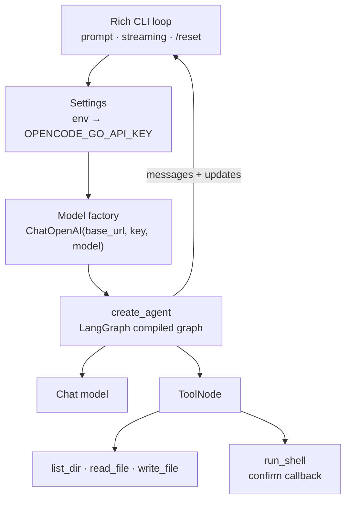

# Baby LangGraph Code Agent - Plan

[English](2026-11-20-1054-feat-langgraph-code-agent-plan.md) | 简体中文

## Goal Capsule

- **目标（Objective）：** 开发者在一个代码仓库里执行一条命令，用自然语言描述编程任务，就能在 Rich 终端界面里看到一个会使用工具的智能体读取、搜索、修改并验证该仓库中的文件。
- **手段（Means）：** 使用 LangChain v1 `create_agent` 构建的 LangGraph 智能体、指向 OpenCode Go 的 OpenAI 兼容聊天模型、限定在工作目录内的文件系统与 shell 工具，以及流式 Rich REPL（KTD1、KTD2、KTD3、KTD4）。
- **权威来源（Authority）：** 本计划决定范围与验证方式；仓库文件决定实现事实；LangChain 文档 MCP 是 API 形态的最终依据。文档与计划冲突时以文档为准，调整计划的实现单元，而不是调整产品需求。
- **执行配置（Execution profile）：** 一个 PR、六个单元、单分支。制定计划时尚无远程仓库，因此交付可能止于本地提交。
- **由谁完成：** `ce-work` 负责实现并提交；`lfg` 根据仓库的远程状态进行评审、简化与交付。

## Product Contract

### Summary

在这个空仓库里构建一个小巧、易读的 Python 编程智能体。它运行交互式终端会话、流式输出模型内容、提供四个工具（`list_dir`、`read_file`、`write_file`、`run_shell`），并在每个进程中保持一个对话线程。它使用 `OPENCODE_GO_API_KEY` 环境变量认证，并调用 OpenCode Go 的 OpenAI 兼容端点。由于 LangChain 生态迭代很快，实现前必须通过 LangChain 文档 MCP 核对 API。

### Problem Frame

该仓库目前没有任何应用代码。从零构建编程智能体，通常只能在“难以看透的框架”和“难以维护的手写工具循环”之间二选一。本项目的目标是给出一个小型参考实现：既便于教学（图与工具循环清晰可见），又保持最新（基于官方文档当前推荐的 LangChain v1 / LangGraph API）。只做终端界面，使项目可以一次读完并保持可评审，也让智能体在任何有 shell 的机器上可用。

### Requirements

**运行时与配置**

- R1. 未设置 `OPENCODE_GO_API_KEY` 时启动，应用以清晰、可操作的错误退出；错误指明变量名，且不打印或回显任何密钥值。
- R2. 聊天模型通过 LangChain 创建并指向 OpenAI 兼容端点：基础 URL 为 `https://opencode.ai/inference/go/openai/v1`，API Key 来自 `OPENCODE_GO_API_KEY`，模型名来自 `OPENCODEGO_MODEL` 并有可用默认值。
- R3. 应用运行于 Python 3.12；在干净检出中，一条 `uv sync` 即可安装其声明的依赖。

**智能体行为**

- R4. 智能体通过循环调用工具来回答编程请求，直到给出最终文本答案；单个请求可能需要多次工具调用。
- R5. 可用工具为 `list_dir`、`read_file`、`write_file`、`run_shell`；每个工具都有模型可用的 docstring，并返回纯文本结果或明确的错误字符串。
- R6. 文件系统工具以进程工作目录为基准解析路径，并拒绝逃逸出该目录的路径。
- R7. `run_shell` 在执行前向用户请求确认，被拒绝时返回明确的“denied”结果；被接受的命令以工作目录为 cwd、在有时限的超时下运行。
- R8. 对话在同一进程内跨轮次保持，后续请求可以引用先前工作；重置命令会开启全新线程。

**终端体验**

- R9. 终端在模型输出产生时即显示，而不是等整段回答结束后才显示。
- R10. 每次工具调用都在终端可见，包含名称与参数的简短摘要；工具失败可见但不会使会话崩溃。
- R11. 会话提供横幅、提示符、按轮次的错误恢复（API 或工具错误只结束当前轮次，不结束进程），以及 `/help`、`/reset`、`/exit` 命令。

### Key Decisions

- **LangChain 文档 MCP 是 API 形态的权威来源。** 用户明确指定；该生态变化快于模型知识。约束 R2、R4、R9。
- **本轮只做终端界面。** 未要求 Web UI 或 TUI 框架，它们会成倍增加未经验证的表面。约束 R9、R10、R11。
- **使用小而明确的工具集，而不是插件注册表。** 四个工具已覆盖读取/搜索/编辑/验证；注册表等到出现第二个消费者再考虑。约束 R5。

### Scope Boundaries

范围内：智能体运行时、四个工具、终端 REPL、配置、测试，以及说明安装与审批行为的 README。

后续工作（Deferred to Follow-Up Work）：持久化（SQLite）检查点、MCP 客户端工具、子智能体、多文件 diff 评审、非交互/无头执行，以及重定向或非 TTY 输出的纯文本渲染器。

不属于本产品定位（Outside this product's identity）：通用 IDE、沙箱容器运行时、托管的多用户服务行为。

### Success Criteria

- 新克隆的仓库只需 `uv sync` 加一个环境变量即可进入可用的提示符。
- 一个有代表性的请求（“读取 README 并补上缺失的章节”）能完成，过程中工具调用可见并给出最终答案。
- `uv run pytest` 无需网络即可通过。
- 终端输出、日志与异常文本中不出现任何密钥值。

## Planning Contract

### Key Technical Decisions

KTD1. **使用 LangChain v1 `create_agent` 构建图。** 文档当前的智能体 API 返回一个已编译的 LangGraph 图，模型/工具循环、检查点与流式输出都已接好。相对于手写 `StateGraph`，选择它是因为文档化 API 才是生态支持的路径，同时它仍暴露 LangGraph 对象以便后续扩展。（指令：用户直接要求“用 LangGraph 构建”；调研确认 `create_agent` 是文档推荐的 LangGraph 路径。）

KTD2. **使用 `langchain-openai` 的 `ChatOpenAI` 对接 OpenCode Go。** OpenCode Go 没有官方的 LangChain 集成；该服务商兼容 OpenAI 协议。用 `base_url`、`api_key` 和模型 ID 构造模型，再把实例传给 `create_agent`。相对于直接调用 `openai` SDK，选择它是因为工具绑定、消息与流式输出都必须保持 LangChain 类型。（指令：用户直接指定环境变量；端点由 R2 固定。）

KTD3. **所有工具锁定在进程工作目录，只对 `run_shell` 设审批。** 读取/列目录/写入都会拒绝逃逸路径（`..`、根目录之外的绝对路径）。shell 是唯一不可逆的表面，因此通过注入的确认回调提示；拒绝会作为普通工具结果返回，模型可以恢复。相对于每次写入都提示，选择它是因为文件编辑是智能体的核心功能，且可被版本控制恢复。

KTD4. **使用 `stream_mode=["messages", "updates"]` 并通过 `rich.Live` 渲染。** `messages` 产出 token 分片，`updates` 产出工具调用与工具结果消息。相对于 `invoke()` 后一次性打印，选择它是因为 R9 要求实时输出，且文档明确记录了这组模式。

KTD5. **模型工厂保持纯粹、可注入。** 设置对象读取环境变量，工厂构建聊天模型与智能体。测试替换为 LangChain 假聊天模型，使测试套件离线运行。相对于模块级单例，选择它是为了让工具循环可被确定性地测试。

KTD6. **使用 `uv`、`pyproject.toml` 与 `src/` 布局。** 机器上已有 `uv`，`.python-version` 已固定 3.12。相对于 `requirements.txt`，选择它是因为锁定与解释器选择免费获得，且无 CI 的本地安装保持一条命令。

KTD7. **使用 `pytest` 与可录制 Rich 控制台进行测试。** `langchain_core` 的假聊天模型可编排工具调用与最终答案；`rich.console.Console(record=True)` 捕获终端输出。相对于真实 API 测试，选择它是因为验证不依赖密钥或网络。

### High-Level Technical Design

轮次顺序：CLI 读取一行输入，把用户消息追加到智能体输入；`messages` 分片流入 `Live` markdown 区块；`updates` 中的工具调用以带边框面板渲染；任何 shell 命令执行前都会提示；随后回到提示符。工具异常在工具边界被转换为错误字符串，因此单个工具失败不会杀死图。

### Assumptions

- OpenCode Go 端点接受 OpenAI 兼容的 chat-completions 请求，并支持工具调用与流式输出。
- 默认模型 `deepseek-v4.1-flash` 对密钥持有者可用；`OPENCODEGO_MODEL` 允许用户不改代码即可换模型。
- 主要平台是使用 `cmd.exe` 的 Windows，但 shell 工具使用平台默认 shell，不能假设只在 POSIX 下可用的命令。
- 不假设沙箱/容器隔离；审批提示就是安全边界。

### Risks & Dependencies

- **LangChain API 漂移。** `create_agent`、流式模式与中间件在不同版本间发生过变化。缓解：在实现时锁定 `langchain` 与 `langgraph` 版本，并在 U4 中通过文档 MCP 核对签名。
- **服务商不兼容。** 工具调用、流式分片形态或认证头可能与 OpenAI 不同。缓解：把模型构造隔离在一个模块中，并在接入 UI 前做协议冒烟。若流式不被支持，该轮无流式运行，UI 打印一行提示；R9 仍要求支持流式的服务商提供流式。
- **数据外发。** 提示词、文件内容与工具输出都会发送到配置的端点。已在 README 中说明并向用户提示，`OPENCODEGO_BASE_URL` 是退出路径。
- **通过被批准命令逃逸 shell。** 用户批准的命令可以做用户本人能做的一切；这是已接受的边界，不是沙箱。

### Open Questions

- 已由真实冒烟解决：OpenCode Go 上的默认模型会流式输出工具调用分片，完整请求同时产生了 `messages` 与 `updates` 事件，并完成了一次工具调用。

## Implementation Units

### U1. 项目脚手架与配置

- **Goal：** 干净检出可通过 `uv sync` 安装，并暴露可运行的模块与控制台入口。
- **Requirements：** R3、R11
- **Dependencies：** 无
- **Files：** `pyproject.toml`、`.python-version`、`.gitignore`、`README.md`、`src/baby_code_agent/__init__.py`、`src/baby_code_agent/__main__.py`、`src/baby_code_agent/cli.py`、`tests/__init__.py`、`tests/test_cli.py`
- **Approach：**
  1. 声明 Python 3.12、运行时依赖（`langchain`、`langgraph`、`langchain-openai`、`rich`）、`dev` 依赖组（`pytest`），以及指向 `cli.main` 的 `baby-code-agent` 控制台脚本。
  2. 在 `.gitignore` 中加入 `.venv`、`__pycache__`、`.env` 与 pytest 缓存。
  3. 创建 `cli.py`，其中 `argparse` 解析器的 `--help` 在加载设置之前退出；`__main__.py` 调用同一个 `main()`。
  4. 参数解析后解析设置；密钥缺失时在横幅或网络导入之前以非零退出码打印 `ConfigError` 信息。
  5. `README.md` 只保留安装、环境变量、命令与 shell 审批说明，不写营销文案。
- **Patterns to follow：** 标准 `src/` 布局；`__main__.py` 委托给 `cli.main`；U5 在此模块上扩展 REPL，而不是替换它。
- **Test scenarios：**
  - `--help` 在无密钥、不构造模型的情况下以 0 退出并打印用法。
  - 未设置 `OPENCODE_GO_API_KEY` 运行时以非零退出并打印变量名。
- **Verification：** `uv sync` 成功，且 `uv run baby-code-agent --help` 在不导入网络栈的情况下打印用法。

### U2. 设置与模型工厂

- **Goal：** 环境配置只解析一次；密钥缺失时明确失败；构建聊天模型时不泄露密钥。
- **Requirements：** R1、R2、R3
- **Dependencies：** U1
- **Files：** `src/baby_code_agent/settings.py`、`src/baby_code_agent/model.py`、`tests/test_settings.py`、`tests/test_model.py`
- **Approach：**
  1. `Settings` 持有 `api_key`、`base_url`、`model`；读取 `OPENCODE_GO_API_KEY`、`OPENCODEGO_BASE_URL`（默认 OpenCode Go 端点）与 `OPENCODEGO_MODEL`（默认 `deepseek-v4.1-flash`）。
  2. `OPENCODE_GO_API_KEY` 缺失或为空白时抛出领域错误；错误消息指明变量名，且从不回显值。
  3. 模型工厂构建 `ChatOpenAI(model=..., api_key=..., base_url=..., temperature=0)` 并设置有界超时；只返回实例，不调用它。
  4. 不调用 `load_dotenv`；密钥只来自进程环境。
- **Test scenarios：**
  - 缺失密钥抛出 `ConfigError`；消息包含 `OPENCODE_GO_API_KEY`，不包含其他环境值。
  - 空白/纯空格密钥视为缺失。
  - 默认值解析为文档中的基础 URL 与默认模型。
  - `OPENCODEGO_MODEL` 覆盖默认值；工厂将其传入模型实例。
  - 工厂输出是 LangChain 聊天模型，其 `model_name` 与 `openai_api_base` 与设置一致。
- **Verification：** 单元测试离线通过；导入模块不需要密钥。

### U3. 文件系统与 shell 工具

- **Goal：** 四个模型可调用的工具在工作目录内工作，拒绝逃逸，并让 shell 执行可审查。
- **Requirements：** R5、R6、R7
- **Dependencies：** U1
- **Files：** `src/baby_code_agent/tools.py`、`tests/test_tools.py`
- **Approach：**
  1. 用 `@tool` 构建工具；通过工厂注入根目录与确认回调，使测试可使用临时目录与桩确认器。
  2. `list_dir(path=".")` 返回排序后的条目并标记目录；`read_file(path)` 返回带行号的 UTF-8 文本，超过大小上限时给出明确错误；`write_file(path, content)` 创建父目录并返回一行摘要。
  3. 所有路径都以工具根目录解析，解析结果在该根目录之外时拒绝。
  4. `run_shell(command)` 将完整、未截断的命令文本传给确认器，并把控制字符、ANSI 转义与换行显示为可见文本；无法无歧义展示的命令直接拒绝。拒绝时返回 `Error: user denied command`；批准后以 cwd=root 运行，带超时、合并 stdout/stderr，非零退出作为工具结果返回而不是抛异常。
  5. 除根目录逃逸规则外，`write_file` 还拒绝解析到 `.git/` 下的目标。
  6. 用明确标记截断过长的工具输出，避免单个文件或命令淹没模型上下文。
- **Test scenarios：**
  - 临时根目录上的 `list_dir` 列出文件并标记子目录；空目录返回明确的“empty”消息。
  - `read_file` 返回带编号内容；缺失文件返回错误字符串而非异常。
  - `read_file("../outside.txt")` 与根目录外的绝对路径被拒绝。
  - `write_file` 创建嵌套父目录并覆盖已有内容；写入字节完全一致。
  - `write_file(".git/hooks/pre-commit", ...)` 被拒绝，而普通源码文件可写。
  - `run_shell` 被拒绝时返回拒绝字符串且不启动进程。
  - 确认器收到的命令保持不变（包括空格与换行），因此展示文本与实际执行一致。
  - `run_shell` 批准后在根目录运行并返回合并输出；失败命令报告非零退出码；超时命令返回超时结果。
- **Verification：** 所有工具测试无需网络即可通过，除 echo 级命令外不依赖开发者 shell 的内容。

### U4. 智能体图组装

- **Goal：** 接入模型与工具的 LangGraph 智能体可执行多步工具循环，并按线程保存历史。
- **Requirements：** R4、R8
- **Dependencies：** U2、U3
- **Files：** `src/baby_code_agent/agent.py`、`tests/test_agent.py`
- **Approach：**
  1. 用 `create_agent(model, tools, system_prompt=..., checkpointer=InMemorySaver())` 构建智能体；在写调用前通过 LangChain 文档 MCP 核对确切签名与流式契约。
  2. 系统提示词写明工作目录、先检查再修改规则、shell 审批规则，以及验证改动的要求。
  3. 暴露接受模型与工具的函数，使测试可传入编排好的假聊天模型。
  4. 每个进程使用一个 `thread_id`；`/reset` 生成新 id。历史保存在检查点中，而不是本地消息列表。
- **Test scenarios：**
  - 编排好的模型先发出两次连续工具调用再给出最终答案时，每次调用产生一条工具结果消息，最终产生 `AIMessage`；每个编排工具的副作用都可观察到。
  - 同一线程的后续轮次能看到更早的消息（假模型收到的消息列表比新输入更长）。
  - 新线程 id 看不到更早的轮次。
  - 抛异常的工具会变成错误工具消息，图仍能到达最终答案。
- **Verification：** 智能体测试无需网络即可通过；图是已编译的 LangGraph runnable，并接受 `thread_id` 配置。

### U5. Rich 终端 REPL

- **Goal：** 用户运行带流式输出、可见工具活动、shell 审批与会话命令的交互式会话。
- **Requirements：** R7、R9、R10、R11
- **Dependencies：** U4
- **Files：** `src/baby_code_agent/cli.py`、`tests/test_cli.py`
- **Approach：**
  1. 渲染横幅面板与带会话/模型副标题的提示符；用普通提示符读取输入，避免粘贴的多行文本与自定义按键处理冲突。
  2. 把 `messages` 分片流入实时 markdown 渲染器；把 `updates` 中助手的工具调用与工具结果渲染为紧凑面板，参数可截断。
  3. 将工具确认器接到 `rich.prompt.Confirm`，默认“否”；完整展示命令并让转义与换行可见；提示前停止或挂起 `Live`，回答后恢复，使问题与输入保持可读。控制台非交互时拒绝 shell 执行并说明原因。
  4. 处理 `/help`、`/reset`、`/exit`；把 EOF 与 Ctrl+C 视为干净退出；按轮次捕获模型/API 异常，打印带异常类与消息的红色短提示，再返回提示符。
- **Test scenarios：**
  - `/help` 打印命令列表；`/exit` 结束循环；EOF 同样结束。
  - `/reset` 更改线程 id 且进程继续存活。
  - 编排好的流式运行渲染助手文本与工具面板；`Console(record=True)` 输出包含工具名。
  - 确认器返回 false 时 shell 工具调用渲染拒绝信息，且该轮仍能完成。
  - 模型异常打印错误后仍接受下一个提示符。
- **Verification：** 使用录制控制台的测试通过；手动运行可见横幅、提示符与流式输出。

### U6. 端到端验证、文档与密钥卫生

- **Goal：** 文档中的流程确实可用，且没有密钥能通过输出泄露。
- **Requirements：** R1、R3、R9、R10、R11
- **Dependencies：** U1-U5
- **Files：** `README.md`、`tests/test_end_to_end.py`
- **Approach：**
  1. 添加离线端到端测试，用假模型构建真实 CLI 接线，输入编排好的请求，断言最终渲染轮次包含答案与工具活动。
  2. 记录环境变量、安装、运行、测试、模型覆盖、审批默认值、已批准 shell 命令不受沙箱限制的已知限制，以及提示词、文件内容与工具输出会发送到配置端点；并把 `OPENCODEGO_BASE_URL` 说明为退出路径。
  3. 添加测试断言 `ConfigError` 与已记录异常从不包含配置的密钥值。
- **Test scenarios：**
  - 编排好的端到端轮次在录制控制台中产生预期最终文本。
  - 渲染输出与抛出的错误文本从不包含哨兵密钥字符串。
  - README 命令与项目实际入口一致。
- **Verification：** `uv run pytest` 全部通过；有真实密钥时手动冒烟完成一次只读请求。

## Verification Contract

| 关卡 | 命令 | 适用 |
|---|---|---|
| 安装 | `uv sync` | U1-U6 |
| 测试 | `uv run pytest` | U1-U6 |
| 入口 | `uv run baby-code-agent --help` | U1、U5 |
| 真实冒烟（手动，需要密钥） | `uv run baby-code-agent` 后发送只读请求 | U6 |

测试不得依赖 `OPENCODE_GO_API_KEY` 或网络。真实冒烟是唯一依赖网络的检查；有密钥时记录为手动证据，没有密钥时实现报告该缺口，而不是声称已通过。

## Definition of Done

- 六个单元全部实现，且在干净环境中 `uv run pytest` 通过。
- 无密钥时 `uv run baby-code-agent --help` 可用；无密钥启动会话会打印可操作的 `OPENCODE_GO_API_KEY` 错误。
- 有密钥（或测试中的假模型）的会话显示流式输出、可见工具调用、可用的 `/help`、`/reset`、`/exit`，以及默认选“否”的 shell 确认。
- 输出、错误消息与已提交文件中不出现任何密钥值；diff 中不残留被放弃的实验代码。
- `README.md` 与交付的命令一致，并说明审批边界。
